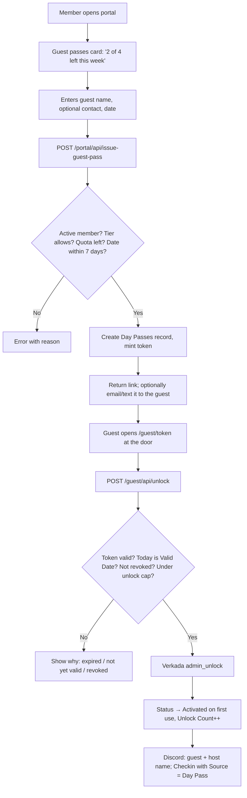

# Member-Issued Guest Passes

Members issue free, single-day guest passes from the portal. A pass is an
unlock link; the guest taps it at the front door. Built 2026-10-14; the
"decided" and "proposed" notes below record how the design was settled.

## Key files

| Piece | File |
|---|---|
| Rules: allowances, week bounds, pass window, state | `app/lib/guest-passes.ts` (+ tests) |
| Airtable reads/writes, token generation | `app/lib/guest-passes-server.ts` |
| Portal API: list, issue, revoke | `app/portal/api/guest-passes/route.ts`, `.../revoke/route.ts` |
| Portal card | `app/portal/GuestPasses.tsx` (rendered from `app/portal/page.tsx`) |
| Guest page | `app/guest/[token]/page.tsx` |
| Guest API: validate, unlock | `app/guest/api/validate/route.ts`, `app/guest/api/unlock/route.ts` |

Members should be able to issue a free, single-day guest pass from the portal:
the guest's access ends at the end of that day, each member gets a weekly
allowance set by their tier, and we record who the guest was.

## What exists today

| Piece | Where | Notes |
|---|---|---|
| Paid member guest pass ($25) | `app/portal/DayPassPurchase.tsx` → `POST /portal/api/create-day-pass-checkout` → Stripe webhook | Creates a People record for the guest, a Day Passes record with `Issued By`, emails the guest a magic link. |
| Guest activation | `POST /portal/api/activate-day-pass`, `/day-pass/activate` | Shows the **shared** day-pass code from the Verkada "Day Pass User" (`VERKADA_UUID`). That code is static; expiry is only tracked in Airtable, not enforced at the door. |
| Event door links | `/door?evt=<token>` → `app/door/api/{validate,unlock}` | A 12-char token on the Events record; the page shows an **Unlock door** button that calls Verkada `admin_unlock`, only inside the event's time window. Throttled per token and per IP. |
| Personal PINs | `/portal/api/verkada-pin` | Reads and sets a member's own Verkada `entry_code`. |
| Weekly code rotation | `/api/cron/rotate-door-code` | Being deprecated. |
| Check-in tracking | `/api/cron/sync-checkins` | Maps Verkada door events to People by email, writes Checkins with `Source` = Verkada / Day Pass / Manual. |
| Tier gating | `canIssueGuestDayPass()` in `app/lib/membership.ts` | Core, Resident, Private Office, Volunteer, Friend, Staff. |

Verkada API facts that matter (from apidocs.verkada.com):

- Each access user has a unique `entry_code`, plus `start_date` and `end_date`
  (Unix seconds). `PUT /access/v1/access_users/user/end_date` revokes all of a
  user's access methods after that time. We already call
  `PUT .../user/entry_code?override=true` in the rotation cron.
- `POST /access/v1/door/admin_unlock` opens a door remotely; we already use it.

## Goal

1. A member opens the portal, enters a guest's name, and gets something to hand
   the guest that opens the front door **today only**.
2. Access stops at 11pm Pacific on the issue day, enforced by the system, not by
   convention.
3. Each member can issue N passes per week, where N depends on tier. Staff are
   unlimited. **Decided:** the free weekly allotment replaces the $25 purchase
   as the default; the paid pass is only offered once the week's allotment is
   used up.
4. Every pass records the host, the guest's name, when it was issued, and when
   it was first used.

## How the guest gets through the door

Two workable designs. Both share the same portal UI, quota logic, and Airtable
records; they differ only in what the guest receives.

### Option A: unlock link (recommended first step)

Reuse the event door-link pattern. The pass is a link like
`moxsf.com/guest/<token>`. The guest opens it at the door and taps **Unlock
door**; the server checks the token, that it's still the issue day, and that
the pass isn't revoked, then calls `admin_unlock`.

- **Verkada changes: none.** Airtable changes: a few fields (below).
- Expiry is exact and enforced server-side. Revocation is instant.
- Every unlock is logged with the guest and host names, so we can post to
  Discord and write a Checkin.
- "Single-use" becomes "one guest, one day, capped at ~10 unlocks" to limit
  forwarding. Verkada can't enforce one-swipe-only for PINs either.
- Downside: the guest needs a phone with data at the door. No keypad fallback.

### Option B: per-guest expiring door code

Give the guest a real 6-digit code that works on the keypad.

- Keep a small fixed pool of Verkada access users ("Guest Pass 01" … "Guest
  Pass 20"), created once in Command and placed in the front-door access group.
  Their UUIDs live in env or a small Airtable table.
- Issuing a pass claims a free pool slot for the day, sets a fresh random
  `entry_code` (`override=true`), sets `start_date` = now and `end_date` = 11pm
  PT. Verkada enforces expiry at the door. A nightly cron frees slots and
  scrambles the codes.
- Pool size = max concurrent guest passes in one day. 20 covers a busy day;
  issuing fails gracefully when the pool is full.
- Downside: one-time Verkada setup, pool management, and door events for the
  guest show up under "Guest Pass 07" rather than the guest's name (we'd map
  them back through our own records).

Recommendation: ship Option A first. It needs no Verkada or Command work, it's
mostly code we already have, and it gives the best audit trail. Add Option B
later if guests regularly arrive without phones. The data model below supports
both: the `Code` field is empty for link passes and holds the PIN for code
passes.

## Data model (Airtable)

Reuse the existing **Day Passes** table rather than adding a new one.

| Field | Change | Purpose |
|---|---|---|
| `Pass Type` | add option **Guest Pass** | Distinguishes free member-issued passes from paid ones. |
| `Guest Name` | new, text | Who the pass is for. Required. We do **not** create a People record for the guest, so the People table stays clean. |
| `Guest Email` | new, email | The guest's email, for contacting them if needed. Required. Not used to send the link. |
| `Token` | new, text | 12-char random token for the unlock link. |
| `Valid Date` | new, date | The day the pass works. Default today. The 8am–11pm window is derived in code. |
| `Unlock Count` | new, number | Incremented on each unlock. |
| `First Used` | new, dateTime | First unlock. |
| `Issued By Email` | new, lookup | Host's email via Issued By, so the app can filter a host's passes. |
| `Issued By`, `Status` | existing | Host; Unused / Activated / Expired / **Revoked** (new option, added by typecast). |

A keypad-code variant (Option B) would add a `Code` field; not built.

Weekly quota is computed, not stored: count Guest Pass records with
`Issued By` = member and `Valid Date` in the current Monday-to-Sunday Pacific
week. No new field needed.

## Flow

Portal pieces:

- A **Guest passes** section on `/portal` showing remaining passes this week,
  the list of passes issued this week with status, a **Revoke** action, and
  the issue form. The existing paid guest-pass purchase stays as the fallback
  once the free allowance is used up.
- Guest page `/guest/<token>`: Mox address, "valid today until 11pm", the
  host's first name, and the Unlock button. Built from `app/door/page.tsx`.

Server pieces:

- `GET`/`POST /portal/api/guest-passes` (member auth, quota and tier checks)
  and `POST /portal/api/guest-passes/revoke`.
- `POST /guest/api/validate` and `POST /guest/api/unlock` (public, token-gated,
  throttled like the event door routes). Unlock posts to Discord
  #notifications; no Attendance record is written, since guests have no
  People record.
- Quota rules in `app/lib/guest-passes.ts` with unit tests, next to
  `membership.ts`.

## Weekly allowance by tier

**Decided:** allowances are per week, not per day. The week runs Monday 00:00
to Sunday 23:59 Pacific. Proposed numbers (Austin's mockup):

| Tier | Passes per week |
|---|---|
| Core | 2 |
| Resident | 4 |
| Private Office | 6 per person |
| Volunteer | 2 (same as Core, since volunteers hold a Core membership) |
| Program / Guest Program / Friend | 0 (can still buy the $25 pass) |
| Staff | unlimited |

The pricing table's "Guest passes" row (`app/components/MembershipPricingTable.tsx`)
and the join FAQ guest-policy paragraph (`app/join/page.tsx`) currently say
1/day and 2/day; both change to the per-week numbers as part of this work.

## Copy (decided 2026-10-14)

Portal card:

- Heading: **guest passes**
- Intro: "bring a friend for the day." then "**2 of 4 left this week** · resets monday"
- Fields: "guest's name", "guest's email"; button: "create pass"
- Helper: "valid today, 8am–11pm. click button to generate link."
- Over quota: "you've used this week's 4 passes. more on monday." followed by
  "need one sooner? buy a day pass for your guest ($25)." and the existing
  purchase form.
- Empty name: the button does nothing and an inline error appears under the
  field: "enter your guest's name". The API also rejects a blank name (400),
  so the check doesn't depend on the browser.

Guest page:

- "Robin invited you to **Mox**", then a green block: "Pass for Priya
  Natarajan" / "Valid today until 11pm"
- "1680 Mission St, San Francisco. Tap below when you're at the front door."
- Button: "Unlock front door"; footnote: "Sign in at the lobby when you arrive."
- After tapping: "Door unlocked" / "Pull the door open. Welcome in."
- Expired: "This pass expired" / "It was valid on Oct 14." / "Check with
  Robin for a new one." (the host's first name, never Mox staff)

Guest contact: **Decided (revised 2026-10-15):** name and email are both
required, so Mox can reach a guest if needed. We still don't email the guest;
the member copies the link and sends it themselves. No People record is
created for the guest.

## Remaining decisions and proposed defaults

1. **Link or code first?** Proposed: unlock link, with keypad codes as a later
   addition if guests arrive without phones.
2. **Future-dated passes:** proposed: allow a Valid Date up to 7 days out,
   default today. A future-dated pass counts against the week it's valid in.
4. **Hours:** proposed: valid from 8am to 11pm Pacific on the Valid Date, so a
   link can't open the door in the middle of the night.
5. **Over-quota behavior:** **Decided:** show the existing $25 purchase form
   with a note that this week's allotment is used up.
6. **Private Office allowance:** proposed: per person, counted against the
   individual member who issues the pass.
7. **Revocation:** proposed: the host can revoke from the portal; staff can
   revoke any pass from the admin area.

## Rough effort

- Option A end to end: about a day of work, plus Airtable field creation.
- Option B on top of A: another day, plus creating the Verkada pool users in
  Command and confirming the create/entry-code/end-date calls against the live
  API (the docs don't state entry-code length limits, so we should test with
  one pool user first).
